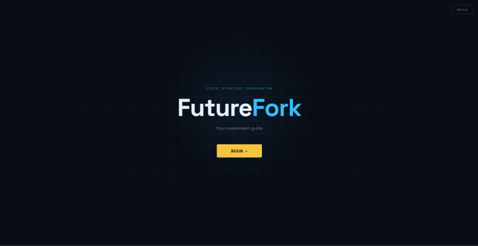
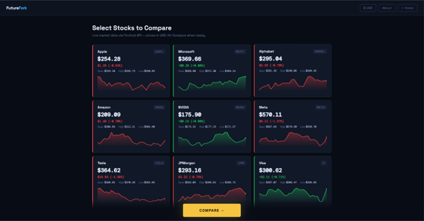
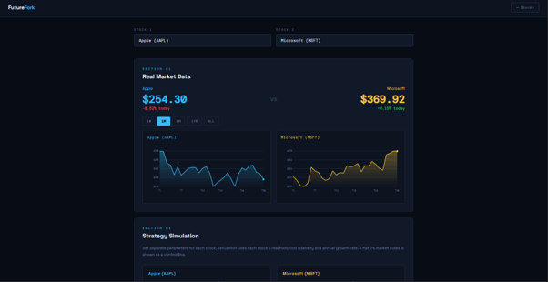
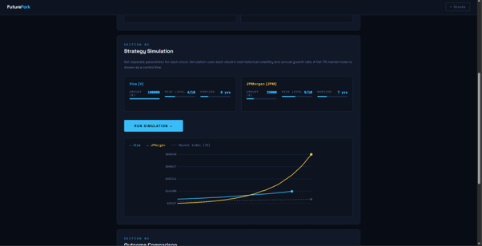
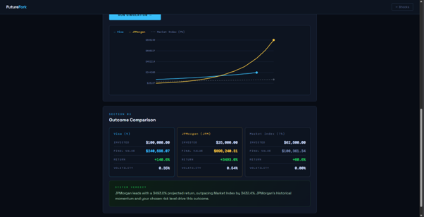

# FutureFork

FutureFork is a web application that allows users to compare popular US stocks using live market data and explore different investment strategies through an interactive simulation.

The project was developed as part of my Web Programming coursework at VIT Vellore using React and the Finnhub API.

## What it does

- Displays live prices for 10 popular US stocks
- Compares two stocks side by side
- Generates interactive price charts
- Simulates investment outcomes based on user-selected investment amount, risk level, and investment horizon
- Supports both USD and INR pricing

## Built With

- React
- JavaScript
- HTML
- CSS
- Finnhub API
- SVG for custom charts

## Running the project

1. Clone the repository.
2. Replace the placeholder Finnhub API key in `app.js` with your own key.
3. Open `index.html` in your browser.

## Notes

The application uses live stock quotes from the Finnhub API. Historical charts shown in the interface are generated for visualization purposes, while the investment simulator uses a simplified model intended for educational use rather than financial prediction.

## What's next

I'd like to improve this project by:

- Using real historical candle data
- Converting it to a Vite-based React project
- Separating components into individual files
- Improving the investment simulation model

## Screenshots

### Landing Page

### Stock Dashboard

### Compare Stocks

### Strategy Simulation

### Results

---

## Author

**Aarush Shetty**

GitHub: https://github.com/AarushShetty346